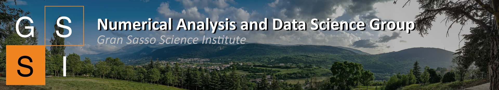

<figure class="gran-sasso-banner">

<figcaption>Photo by Alee Kadhim Obeid</figcaption>
</figure>

# Welcome

We are the Numerical Analysis and Data Science Group at the **Gran Sasso Science Institute**, L’Aquila. We work on mathematical and computational methods for scientific computing, dynamical systems, optimization and machine learning.

This is where we share our seminars, reading group meetings and research activities.

<section class="upcoming-section" aria-labelledby="upcoming-heading">

<h2 id="upcoming-heading">Upcoming seminars</h2>
<a class="calendar-link" href="calendar/">View calendar ↗</a>

See upcoming dates in the <a href="seminar/">NOMADS seminars</a> and <a href="reading_group/">COMPiLE reading group</a> pages.

<a href="seminar/">NOMADS seminars</a> · <a href="reading_group/">COMPiLE reading group</a>

</section>

## Our research

- **Numerical Analysis & Dynamical Systems** — Numerical methods for differential equations, stability, eigenvalue problems and structured matrices.
- **Machine Learning & Data Science** — Learning on graphs, reliable neural networks and mathematical foundations of machine learning.
- **Computational Fluid & Plasma Dynamics** — High-performance methods for hyperbolic PDEs and kinetic models.
- **Quantum Computing** — Quantum algorithms and hardware for combinatorial optimization.
- **Optimization & Optimal Transport** — Algorithms for nonlinear least squares and optimal transport.

[Read more about our research](research.md).

For news, data and code, please also refer to our [GitHub Repository](https://github.com/compilelab). 

## About GSSI
The [Gran Sasso Science Institute (GSSI)](https://www.gssi.it) is an international PhD school and a center for research and higher education in the areas of Physics, Mathematics, Computer Science and Social Sciences. Professors, researchers and students from all scientific backgrounds are selected internationally, following the standards set by the best research centers and PhD schools worldwide.

