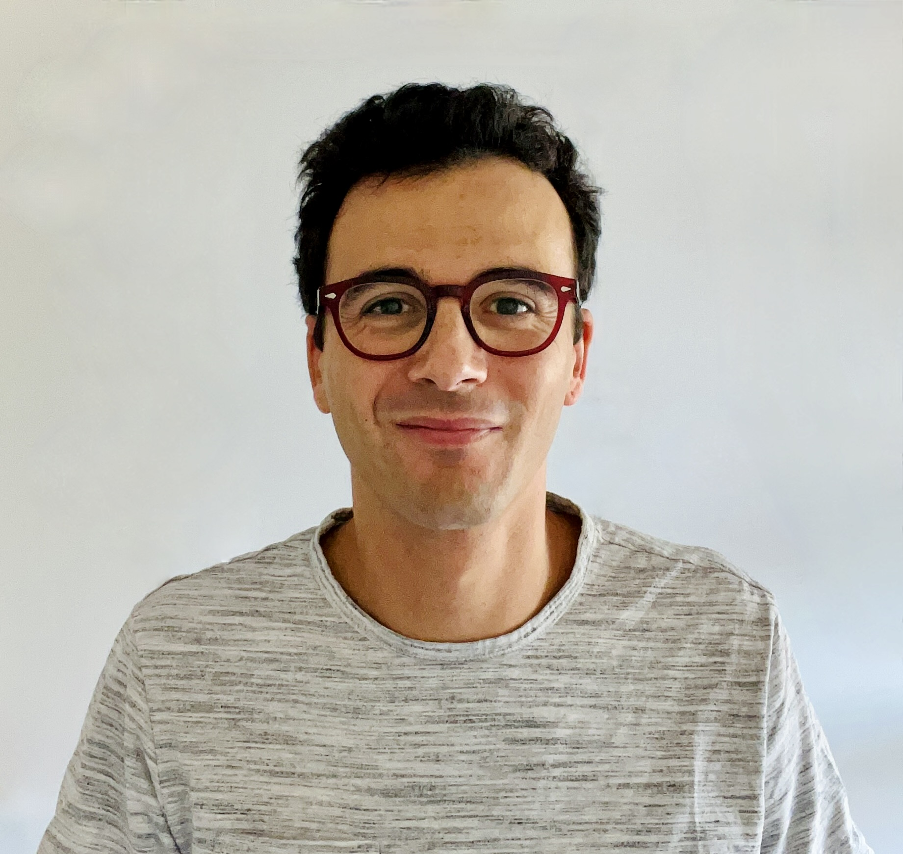
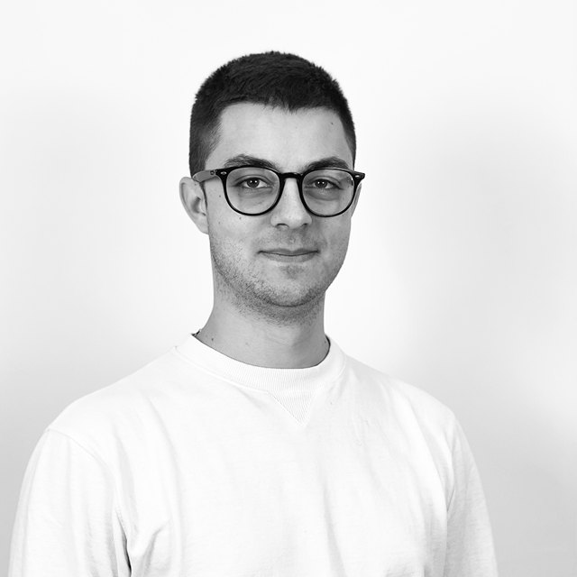
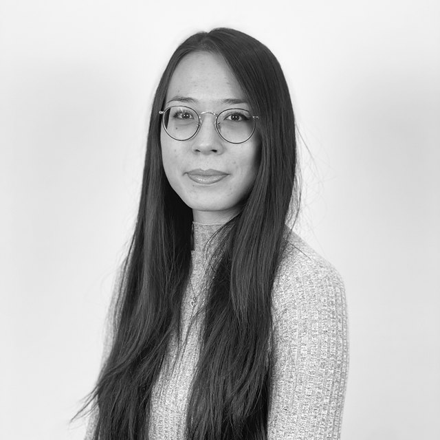
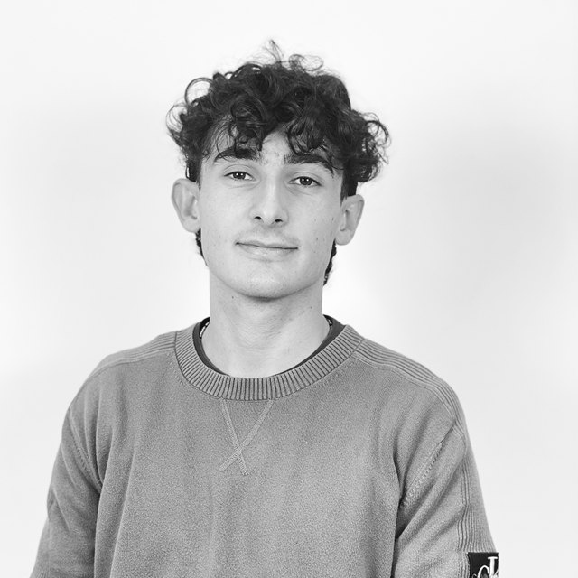

# People

Meet the faculty, postdoctoral researchers and PhD students in our group.

## Faculty

### Nicola Guglielmi

*Professor of Numerical Analysis*

Nicola Guglielmi is a full professor of Numerical Analysis and Chair of the Doctoral School in Mathematics at GSSI. His research concerns numerical methods for ordinary and delay differential equations, stability of dynamical systems, and matrix perturbation theory. He develops computational methods for large-scale problems in control, matrix analysis and pseudospectra.

[Personal webpage](https://www.gssi.it/people/professors/lectures-maths/item/545-guglielmi-nicola)

### Francesco Tudisco

*Associate Professor (Reader) in Machine Learning*

Francesco Tudisco is affiliated with the University of Edinburgh, the Maxwell Institute for Mathematical Sciences and GSSI. His research connects machine learning, numerical analysis and scientific computing. His interests include physics-inspired deep learning, learning on graphs, efficient neural networks, and the robustness and mathematical foundations of deep learning.

[Personal webpage](https://ftudisco.gitlab.io/)

## Postdocs

### Marco Sutti

*Postdoctoral researcher*

Marco Sutti works on Riemannian optimization, matrix manifolds, low-rank matrix and tensor decompositions, and computational geometry. He obtained his PhD in Mathematics from the University of Geneva in 2020 and an MSc in Computational Science and Engineering from EPFL. After a postdoctoral position at NCTS in Taiwan, he joined GSSI in August 2025.

[Personal webpage](https://marcosutti.net/) · [GSSI profile](https://www.gssi.it/people/post-doc/post-doc-maths/item/25886-sutti-marco)

### Asma Farooq

*Postdoctoral researcher*

[GSSI profile](https://www.gssi.it/people/post-doc/post-doc-maths/item/21252-farooq-asma)

<!-- Add a short research biography here when available. -->

### Francesco Paolo Maiale

*Postdoctoral researcher*

<!-- Add a short research biography here when available. -->

## PhD Students

### Damiano Scevola

*PhD student*

Damiano Scevola is a PhD student in Applied Mathematics at GSSI. He obtained Bachelor’s degrees with honours in Computer Science and Physics and a Master’s degree with honours in Theoretical Physics from the University of Bologna. His theses explored qubit usage in quantum circuits, the connection between the Unruh effect and Hawking radiation, and Hadamard regularization in Quantum Field Theory.

### Claudia Yuuko De Iuliis

*PhD student*

Claudia Yuuko De Iuliis obtained her Bachelor’s degree in Mathematics and her Master’s degree in Applied Mathematics at Sapienza University of Rome. Her interests include probability and its connections with quantum phenomena. Her Bachelor’s thesis concerned the Boltzmann equation, while her Master’s thesis studied a gradient-flow formulation for a class of Quantum Markov semigroups.

[Personal webpage](https://it.linkedin.com/in/claudia-yuuko-de-iuliis-7ab7081aa)

### Francesco Di Cuia

*PhD student*

Francesco Di Cuia is interested in numerical methods for solving mathematical problems. In his Master’s thesis, he studied the convergence of the Finite Element Method (FEM) and Virtual Element Method (VEM) on anisotropic meshes.

### Eugenio Turchet

*PhD student*

Eugenio Turchet works on numerical linear algebra and structured matrix nearness problems, with a focus on correlation and covariance matrices. His research concerns efficient eigenvalue and eigenvector computations and fast solvers that preserve matrix structure. He obtained his Bachelor’s and Master’s degrees in Mathematics from the University of Bologna, studying projection and Krylov methods for matrix equations.

[GSSI profile](https://www.gssi.it/people/students/students-maths/item/25520-turchet-eugenio)

### Bernardo Collufio

*PhD student*

Bernardo Collufio studies numerical methods for kinetic PDEs, with applications in gas dynamics, fluid dynamics and plasma physics. His interests include high-order accuracy, asymptotic-preserving methods and physical consistency. He obtained his Bachelor’s degree at the University of Messina and his Master’s degree at the University of Pavia. He also helps maintain the group website and organize COMPiLE meetings.

[GSSI profile](https://www.gssi.it/people/students/students-maths/item/24622-collufio-bernardo)

### Emanuele Zangrando

*PhD student*

[GSSI profile](https://www.gssi.it/people/students/students-maths/item/20024-zangrando-emanuele)

<!-- Add a short research biography here when available. -->

### Francesco Fabbri

*PhD student*

Joint supervision with [Prof. Francesco Viola](https://www.gssi.it/people/professors/lectures-maths/item/7942-viola-francesco).

[GSSI profile](https://www.gssi.it/people/students/students-maths/item/20026-fabbri-francesco)

<!-- Add a short research biography here when available. -->

### Grigorii (Grisha) Buklei

*PhD student*

Grigorii (Grisha) Buklei works on mathematical modeling, Bayesian experimental design and algorithmic game theory. He holds a BSc in Applied Mathematics and Information Science from the Higher School of Economics, Moscow, where he was also a research intern at the Complex Systems Modelling and Control Laboratory. His PhD at GSSI is supported by a PNRR fellowship.

[GSSI profile](https://www.gssi.it/people/students/students-maths/item/24620-buklei-grigorii)

### Helena Biscevic

*PhD student*

Joint supervision with [Prof. Raffaele D’Ambrosio](http://people.disim.univaq.it/~raffaele.dambrosio/).

[GSSI profile](https://www.gssi.it/people/students/students-maths/item/15655-biscevic-helena)

<!-- Add a short research biography here when available. -->

### Pietro Sittoni

*PhD student*

Pietro Sittoni works on stable deep equilibrium models and mathematical optimization. He studies subhomogeneous operators and their fixed points, with applications to implicit neural networks. He holds an MSc in Data Science from the University of Padova, where his thesis explored how these ideas can support the design of stable learning models.

[GSSI profile](https://www.gssi.it/people/students/students-maths/item/24623-sittoni-pietro)

### Rinat Kamalov

*PhD student*

Joint supervision with [Prof. Vladimir Protasov](https://www.disim.univaq.it/VladimirProtassov).

[GSSI profile](https://www.gssi.it/people/students/students-maths/item/20017-kamalov-rinat)

<!-- Add a short research biography here when available. -->

### Sara Tarquini

*PhD student*

[GSSI profile](https://www.gssi.it/people/students/students-maths/item/20023-tarquini-sara)

<!-- Add a short research biography here when available. -->

## Former Members

- Anton Savostianov (PhD student)
- Alessia Andò (PostDoc)
- Konstantin Prokopchik (PhD student)
- Mattia Manucci (PhD student)
- Miryam Gnazzo (PhD student)
- Stefano Sicilia (PhD student)
- Arturo De Marinis (PhD student)
- Piero Deidda (PostDoc)
